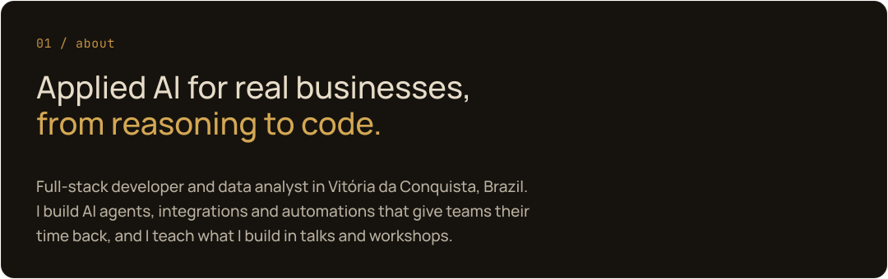
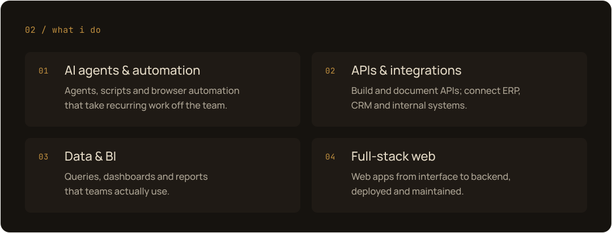
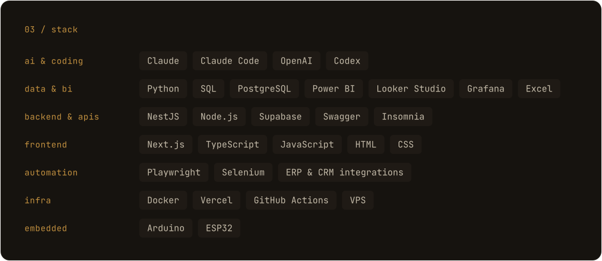

  <picture>
    <source media="(prefers-color-scheme: light)" srcset="assets/github-banner-polido.svg">
    <source media="(prefers-color-scheme: dark)" srcset="assets/github-banner-onix.svg">
    
  </picture>

  
  
   
  
  

  

<!-- painéis gerados por tools/gerar-assets.mjs: edite o CONTEUDO lá e rode de novo -->
