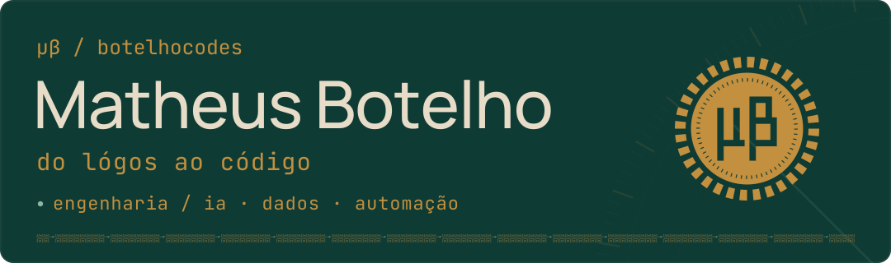

  <picture>
    <source media="(prefers-color-scheme: light)" srcset="assets/github-banner-polido.svg">
    <source media="(prefers-color-scheme: dark)" srcset="assets/github-banner-onix.svg">
    
  </picture>

  
  
   
  
  

## About Me

I'm a mid-level full-stack developer and data analyst based in Vitória da Conquista, Brazil. I build web applications, connect business systems, and automate workflows that help teams put their data to use.

## What I Do

<table>
  <tr>
    <td width="50%" valign="top">
      <strong>Full-Stack Development</strong> 
      Build web applications and connect their interfaces to backend services.
    </td>
    <td width="50%" valign="top">
      <strong>APIs and Integrations</strong> 
      Build and document APIs and connect systems such as ERP and CRM platforms.
    </td>
  </tr>
  <tr>
    <td width="50%" valign="top">
      <strong>Data and Business Intelligence</strong> 
      Query data, build dashboards, and turn business metrics into reports teams can use.
    </td>
    <td width="50%" valign="top">
      <strong>Process Automation</strong> 
      Use scripts, APIs, and browser automation to reduce recurring manual work.
    </td>
  </tr>
</table>

## Tech Stack

<table align="center">
  <tr>
    <td align="center" valign="top" width="310">
      <strong>Data &amp; Business Intelligence</strong>  
      
      
      
      
       
      
      
        
      Power BI · Looker Studio · Grafana · Microsoft Excel · Python · SQL · PostgreSQL
    </td>
    <td align="center" valign="top" width="310">
      <strong>Frontend &amp; Web</strong>  
        
      Next.js · TypeScript · JavaScript · HTML · CSS
    </td>
  </tr>
  <tr>
    <td align="center" valign="top" width="310">
      <strong>Backend &amp; APIs</strong>  
      
      
        
      NestJS · Node.js · Supabase · Insomnia · Swagger · APIs
    </td>
    <td align="center" valign="top" width="310">
      <strong>Infrastructure &amp; Deployment</strong>  
      
        
      Docker · Vercel · GitHub · VPS hosting
    </td>
  </tr>
  <tr>
    <td align="center" valign="top" width="310">
      <strong>Testing &amp; Browser Automation</strong>  
      
        
      Playwright · Selenium
    </td>
    <td align="center" valign="top" width="310">
      <strong>AI &amp; Coding Tools</strong>  
      
      <picture>
        <source media="(prefers-color-scheme: light)" srcset="https://upload.wikimedia.org/wikipedia/commons/6/66/OpenAI_logo_2025_%28symbol%29.svg">
        
      </picture>
      
      <!-- OpenAI Blossom and Codex desktop app icon are OpenAI brand assets. -->  
      Claude · Claude Code · OpenAI · Codex
    </td>
  </tr>
  <tr>
    <td align="center" valign="top" width="310">
      <strong>Business Systems &amp; Integrations</strong>  
        
      ERP · CRM · API integrations
    </td>
    <td align="center" valign="top" width="310">
      <strong>Embedded Prototyping</strong>  
      
        
      Arduino · ESP32
    </td>
  </tr>
</table>

## Contributions

  

