  

  
  

---

## Sobre mim

Sou de Vitória da Conquista, BA, e atuo no desenvolvimento full stack e na análise de dados. Combino essas duas frentes para conectar sistemas, automatizar processos e facilitar o uso dos dados no dia a dia.

## O que eu faço

<table>
  <tr>
    <td width="50%" valign="top">
      <strong>Desenvolvimento full stack</strong> 
      Desenvolvimento de aplicações web e da lógica que conecta as interfaces aos serviços.
    </td>
    <td width="50%" valign="top">
      <strong>APIs e integrações</strong> 
      Desenvolvimento de APIs e troca de informações entre sistemas com TypeScript, Node.js e NestJS.
    </td>
  </tr>
  <tr>
    <td width="50%" valign="top">
      <strong>Análise de dados</strong> 
      Consultas e análise com SQL, PostgreSQL e Python.
    </td>
    <td width="50%" valign="top">
      <strong>Automação de processos</strong> 
      Uso de scripts, APIs e dados para reduzir tarefas manuais recorrentes.
    </td>
  </tr>
</table>

---

## Tech Stack

<table align="center">
  <tr>
    <td align="center" width="310">
      <strong>Backend e APIs</strong>  
        
      TypeScript · Node.js · NestJS
    </td>
    <td align="center" width="310">
      <strong>Dados e automação</strong>  
      
      
        
      Python · SQL · PostgreSQL
    </td>
  </tr>
</table>

<!-- Adicione aqui os projetos públicos que quiser destacar. -->

---

## Contribuições

  

